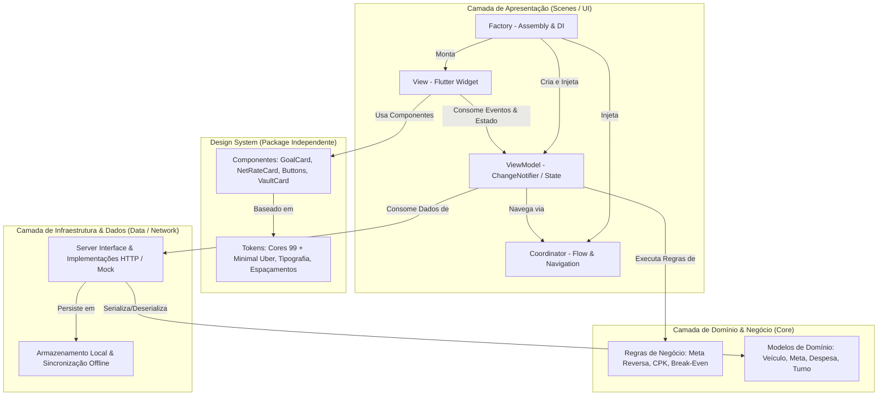

# FINDRIVE — Especificação Técnica e Funcional do Produto
**Versão:** 1.0.0  
**Status:** Aprovado para Engenharia  
**Papeis:** Arquiteto de Software & Product Owner Sênior  
**Stack Principal:** Flutter / Dart (Mobile), Clean Architecture + MVVM-C, REST API  

---

## 1. Visão Geral do Produto e Posicionamento Estratégico

### 1.1 Declaração do Problema
Motoristas e entregadores de aplicativo (Uber, 99, iFood, Indrive, Rappi) enfrentam uma ilusão financeira crônica: o faturamento bruto diário gera uma falsa sensação de renda disponível. Na prática:
1. **Confusão Patrimonial:** Mistura de contas domésticas (alimentação, aluguel da casa, contas de consumo) com despesas operacionais do veículo (combustível, seguro, manutenção preventiva e corretiva).
2. **Custo Invisível por KM (CPK):** Desgaste de pneus, óleo, freios, correias e depreciação veicular não são contabilizados no dia a dia, gerando um "rombo" financeiro quando ocorre uma pane mecânica.
3. **Ponto de Equilíbrio Indeterminado (*Break-Even*):** Motoristas de carros alugados ou financiados rodam dezenas de horas no início da semana apenas para cobrir o custo da máquina, sem saber exatamente a partir de qual corrida começam a lucrar.
4. **Jornadas Excessivas e Ineficientes:** Falta de clareza sobre o valor real limpo ganho por hora ($\text{R\$}/\text{hora líquido}$), levando a turnos de 14 a 16 horas em horários de baixa demanda.

### 1.2 Proposta de Valor
O **FINDRIVE** é um copiloto financeiro inteligente e visual, projetado para transformar o motorista de aplicativo em um microempresário de alta performance. Através da **Calculadora de Meta Reversa Diária**, o aplicativo consolida as contas da casa e os custos do veículo, desconta automaticamente a retenção preventiva para imprevistos (8% a 12%), monitora em tempo real a hora líquida real rodada e indica os turnos mais lucrativos (*Smart Shift*).

---

## 2. Personas e Cenários de Uso

### Persona 1: Carlos, 38 anos — Motorista com Carro Alugado (UberX / 99Pop)
* **Contexto:** Aluga um Chevrolet Onix por R$ 680,00/semana.
* **Dor:** Trabalha segunda e terça-feira estressado porque tudo o que recebe é debitado pela locadora.
* **Solução FINDRIVE:** O app indica visualmente o *Break-Even*: "Faltam 18 corridas para quitar o aluguel da semana. A partir de quarta-feira, 11:30h, cada corrida é lucro líquido no seu bolso".

### Persona 2: Juliana, 29 anos — Motorista com Carro Próprio Financiado
* **Contexto:** Parcela de R$ 1.100,00/mês + IPVA + Seguro. Roda 4.500 km/mês.
* **Dor:** Foi surpreendida com R$ 1.800,00 na troca de suspensão e 4 pneus, tendo que recorrer a empréstimos com juros altos.
* **Solução FINDRIVE:** Carteira de Manutenção Automática retém 10% da meta diária em um saldo virtual destacado, alertando quando a troca de óleo ou pneus está próxima com base no hodômetro.

### Persona 3: Roberto, 24 anos — Entregador de Moto (iFood / 99Moto)
* **Contexto:** Honda CG 160 própria. Roda 180 km/dia.
* **Dor:** Combustível sobe com frequência e o desgaste de relação e pneus é agressivo.
* **Solução FINDRIVE:** Cálculo rápido de CPK específico para motocicletas, com metas dinâmicas ajustadas pelo custo diário da gasolina e alertas de manutenção frequente.

---

## 3. Regras de Negócio e Formulações Matemáticas

### 3.1 Motor de Meta Reversa Diária
A meta de faturamento não parte do quanto o motorista *deseja rodar*, mas sim do quanto ele *precisa pagar e lucrar*.

$$\text{Custo Fixo Total Mensal} (C_{total}) = C_{casa} + C_{veiculo\_fixo}$$

Onde:
* $C_{casa}$: Aluguel residencial, contas de consumo (água, luz, internet), alimentação básica, educação, planos pessoais.
* $C_{veiculo\_fixo}$: Aluguel semanal anualizado/mensalizado OU (parcela financiamento + IPVA/12 + Seguro/12 + Licenciamento/12).

$$\text{Dias Trabalhados no Mês} (D_{uteis}) = D_{calendario} - D_{folgas\_programadas}$$

$$\text{Custo Fixo Diário} (C_{dia}) = \frac{C_{total}}{D_{uteis}}$$

$$\text{Meta Líquida Diária} (M_{liq}) = C_{dia} + \text{Lucro Desejado Diário}$$

Para cobrir a retenção do Fundo Preventivo ($p_{prev} \approx 8\% \text{ a } 12\%$) e os custos variáveis (combustível médio $p_{comb} \approx 20\% \text{ a } 28\%$):

$$\text{Meta Bruta Diária Reversa} (M_{bruta}) = \frac{M_{liq}}{(1 - p_{prev} - p_{comb})}$$

### 3.2 Ponto de Equilíbrio Semanal (*Break-Even Point*) para Veículo Alugado
Para veículos com custo semanal fixo de locação ($L_{sem}$):

$$\text{Corridas para Break-Even} = \left\lceil \frac{L_{sem}}{\overline{T} \times (1 - \text{taxa}_{plataforma}) - \overline{C}_{combustivel\_corrida}} \right\rceil$$

Onde $\overline{T}$ é o ticket médio bruto por corrida histórica do motorista.

### 3.3 Custo por Quilômetro Rodado (CPK) e Fundo Preventivo
O CPK consolida o desgaste estimado por quilômetro:

$$\text{CPK} = \frac{\text{Custo Troca Óleo e Filtros}}{\Delta KM_{\text{oleo}}} + \frac{\text{Custo Jogo de Pneus}}{\Delta KM_{\text{pneus}}} + \frac{\text{Custo Freios e Discos}}{\Delta KM_{\text{freios}}} + \frac{\text{Custo Revisão Geral}}{\Delta KM_{\text{revisao}}} + \text{Depreciação por KM}$$

* **Depreciação Estimada (Carro Próprio):** R$ 0,10 a R$ 0,18 por km rodado (conforme tabela FIPE e desvalorização por alta quilometragem).
* **Carteira de Manutenção Virtual:** A cada meta atingida, o percentual parametrizado (ex: 10%) é segregado em uma "Carteira de Proteção", impedindo que o motorista assuma esse valor como renda disponível para consumo pessoal.

### 3.4 Gestão da Hora Líquida Real
$$\text{Taxa Horária Líquida} (\text{R\$}/\text{hora}) = \frac{\text{Faturamento Bruto Realizado} - \text{Combustível Efetivo} - (\text{CPK} \times KM_{\text{rodados}}) - C_{dia\_proporcional}}{\text{Horas Online Efetivas}}$$

---

## 4. Requisitos Funcionais (RF)

| ID | Nome do Requisito | Descrição |
|---|---|---|
| **RF-01** | **Perfil do Veículo** | O usuário seleciona Tipo (Carro ou Moto) e Regime (Alugado ou Próprio). Para alugados: valor semanal/mensal e dia de vencimento. Para próprios: parcela, IPVA, seguro, odômetro atual e ano/modelo. |
| **RF-02** | **Despesas 360° (Casa + Carro)** | Cadastro estruturado de despesas fixas da família e custos fixos do transporte, com data de vencimento e categoria. |
| **RF-03** | **Calculadora de Meta Reversa** | Motor central que gera a meta bruta do dia/semana com base no lucro líquido almejado e custos fixos. |
| **RF-04** | **Dashboard em Tempo Real** | Exibição visual da Meta Diária, progresso percentual, valor faturado, saldo restante para a meta e estimativa de horas de trabalho restantes com base no ritmo atual. |
| **RF-05** | **Rastreador de Turno & Hora Líquida** | Botão Iniciar/Encerrar Turno com cronômetro de horas online, km rodado e cálculo dinâmico do R$/hora limpo. |
| **RF-06** | **Carteira de Manutenção (Fundo Preventivo)** | Separação visual de 8% a 12% do faturamento para emergências mecânicas e manutenções programadas com base no CPK. |
| **RF-07** | **Modo Folga Garantida** | Permite ao motorista marcar dias de folga (ex: domingo ou segunda). O algoritmo recalcula e redistribui automaticamente os custos fixos nos dias restantes sem gerar prejuízo no fim do mês. |
| **RF-08** | **Smart Shift (Mapa de Calor)** | Recomendações dos melhores blocos de horário e dias da semana para rodar com base em dados agregados e histórico de faturamento por hora. |
| **RF-09** | **Notificações Inteligentes Contextualizadas** | Alertas push convertendo contas a vencer em esforço de trabalho. Ex: *"Sua conta de energia de R$ 190 vence amanhã! Faltam apenas 2 corridas médias para liquidar"*. |
| **RF-10** | **Leitura Facilitada de Comprovantes (OCR)** | Upload ou foto de comprovantes de abastecimento e prints de fechamento de ganhos da Uber/99 para lançamento rápido sem digitação manual. |
| **RF-11** | **Widget Flutuante Suspenso (Overlay Android)** | Bolha flutuante persistente na tela que exibe meta restante e viabilidade de corrida em tempo real enquanto o motorista utiliza os apps da Uber/99. |
| **RF-12** | **Relatório Fiscal IRPF / MEI** | Exportação de demonstrativo mensal em PDF e CSV com segregação de receita bruta e despesas operacionais dedutíveis (Livro Caixa Digital). |

---

## 5. Requisitos Não-Funcionais (RNF)

| ID | Categoria | Especificação Técnica |
|---|---|---|
| **RNF-01** | **Arquitetura de Software** | Clean Architecture com padrão de apresentação **MVVM-C (Model-View-ViewModel-Coordinator)** + **Factory Pattern** para Injeção de Dependências. |
| **RNF-02** | **Design System Modular** | Package Flutter independente (`packages/design_system`) contendo tokens de cores, tipografia, espaçamento, raio de borda, componentes atômicos e sample app. |
| **RNF-03** | **Identidade Visual Híbrida** | Linguagem visual inspirada no **Design Minimalista da Uber** (preto profundo `#121212`, branco puro, cartões geométricos limpos, micro-bordas sutis) combinado com a energia do **Amarelo 99** (`#FFC700` / `#FFD100`) como cor primária de destaque. |
| **RNF-04** | **Desempenho & Fluidez** | Renderização a 60/120 fps constantes. Inicialização fria (*cold start*) < 1.8 segundos. Consumo reduzido de bateria no modo rastreador de turno. |
| **RNF-05** | **Segurança & Criptografia** | Criptografia local com AES-256 (via `flutter_secure_storage`) para tokens de autenticação e dados financeiros sensíveis. Conformidade com a LGPD. |
| **RNF-06** | **Compatibilidade de SO** | Android 8.0+ (API Level 26+) com permissão especial de `SYSTEM_ALERT_WINDOW` para o widget suspenso. Compatibilidade total com iOS 14.0+. |
| **RNF-07** | **Disponibilidade Offline** | Operação offline-first para registro de turnos, despesas e visualização de metas com sincronização automática quando restabelecida a rede. |

---

## 6. Arquitetura de Software e Padrões de Projeto

### 6.1 Padrão MVVM-C + Factory Aplicado
Cada cena funcional do FINDRIVE é isolada em seu próprio diretório contendo:
1. `*_factory.dart`: Montador único da cena. Cria o servidor de dados, o coordenador de rotas, o view model e injeta no construtor da View.
2. `*_coordinator.dart`: Interface de navegação desacoplada. A View e o ViewModel não conhecem rotas do Navigator do Flutter diretamente.
3. `*_view_model.dart`: Responsável pelo estado reativo (`ChangeNotifier`), computações de tela e comandos.
4. `*_view.dart`: Widget declarativo construído unicamente com os componentes do Design System.
5. `server_*.dart`: Contrato de comunicação de rede/dados que permite fácil substituição entre ambiente de desenvolvimento (Mock rápido) e produção (API REST).

---

## 7. Diretrizes do Design System FINDRIVE

* **Tema 99:** Amarelo `#FFC700` dinâmico e vibrante como elemento condutor de ação, atenção e energia financeira.
* **Estilo Uber Minimalista:**
  * Fundos em tons de preto puro `#000000` e cinza carvão `#121212` no Dark Mode.
  * Superfícies em `#1E1E1E` com bordas sutis em `#2C2C2C`.
  * No Light Mode: fundos em `#FFFFFF` e `#F7F7F7` com texto em preto de alto contraste `#121212`.
  * Tipografia geométrica e robusta, priorizando a legibilidade rápida para quem opera o celular no suporte veicular.
  * Hierarquia de dados com números em destaque (*big numbers*) para metas e métricas de $\text{R\$}/\text{h}$.
